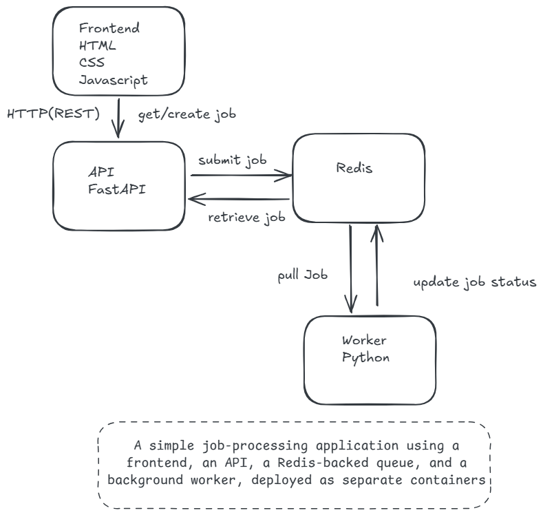
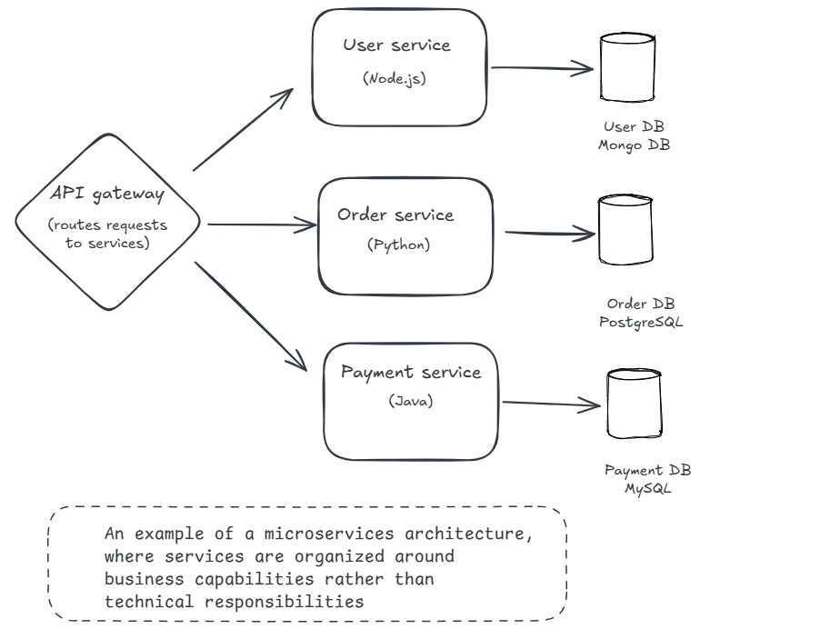

Microservices or Not Microservices?
---

Which architectural style best describes this application?

- [ ] Microservices architecture
- [ ] Monolithic architecture 
- [ ] Something else

When I first saw this architecture, the answer seemed straightforward. My first thought was, "Yes, this is no doubt a microservices architecture."

It fits the description of what I thought microservices were. But after thinking to myself, "what exactly makes it a microservice?" and doing some further research, my perspective changed.

Before discussing what I learnt during my deep dive and why I changed my view, let me share what I based my assumption on.

### WHAT I THOUGHT MICROSERVICES WERE 

If you do a "quick search" on what a microservice is, you might get a definition that is similar to what is in this [GeeksforGeeks article](https://www.geeksforgeeks.org/system-design/microservices/):

"Microservices is an architecture where an application is divided into small, independent services that communicate over a network."

Based on this definition alone, our architecture might appear to fit.

- First, the application is divided into independent components (the frontend, API, and worker).
- Second, they communicate over a network.

So, it must be a microservice! Right? Not quite!

### A BETTER WAY TO DESCRIBE MICROSERVICES

During my research, two resources that helped me better understand microservices were the [article by Martin Fowler and James Lewis](https://martinfowler.com/articles/microservices.html) and the [Martin Fowler GOTO conference talk](https://www.youtube.com/watch?v=wgdBVIX9ifA&t=435s).

Their article offers a better way to think about microservices. Rather than relying on a strict definition, it describes a set of common characteristics.

It is also important to note, as they made clear in the article, that not all microservice architectures have "all" the characteristics they describe. However, most microservice architectures exhibit most of the defined characteristics.

The [article](https://martinfowler.com/articles/microservices.html) discusses nine characteristics commonly associated with microservices.

One of the characteristics helps explain why our architecture, as currently designed, would not typically be classified as a microservices architecture.

According to this [Microsoft article](https://learn.microsoft.com/en-us/azure/architecture/guide/architecture-styles/microservices), dividing an application into separate components that can potentially be developed, deployed, operated, and scaled independently does not, by itself, make it a microservices architecture.

The article states:

*"A microservices architecture consists of a collection of small, autonomous services. Each service is self-contained and should implement a single business capability within a bounded context. A bounded context is a natural division within a business and provides an explicit boundary within which a domain model exists."*

Terms such as *bounded context* and *domain model* come from Domain-Driven Design (DDD).

DDD is an approach to designing software around the business domain.
[Read this](https://learn.microsoft.com/en-us/azure/architecture/microservices/model/domain-analysis) to learn more about DDD.

The main point, which Fowler and Lewis also identify as a characteristic of microservices, is that:

The services in a microservices architecture are typically **designed around business capabilities.**

This is why our frontend, API, and worker design does not typically fit the microservices architectural style. These components are organized around **technical responsibilities** rather than distinct **business capabilities**.

An application designed around business capabilities might look something like this:

Unlike the former architecture, each of these services represents a meaningful area of business functionality.

**The point:** Microservices are typically organized around business capabilities rather than technical responsibilities.

### NOT A MONOLITH EITHER AND NOT ALWAYS CLEAR-CUT

Since we have classified this architecture as not typically meeting the characteristics of a microservices architecture, does that mean it is a monolithic application?

You see, I have come to realize that, like most things in life, software design is not always black and white, this or that. It can have features of one architectural style and not others.

So, just because it is not a microservices architecture does not necessarily mean it is a monolith.

It helps to define what is referred to as a monolith here.

A [monolithic architecture](https://learn.microsoft.com/en-us/dotnet/architecture/modern-web-apps-azure/common-web-application-architectures#traditional-n-layer-architecture-applications) typically describes an application that is built and deployed as a single unit, even if it contains multiple business functions or is organized into layers or modules.

### A BETTER DESCRIPTION

We have established that our architecture would not typically be classified as a microservices architecture. However, something stands out:

The components of this application can run in separate processes and communicate through network mechanisms.

This reminds me of an interesting architectural concept in computing: [distributed architecture](https://aws.amazon.com/what-is/distributed-architecture/)

So, with all we have discussed in mind, I find that the application is best described as a **multi-container application with distributed components**.

### CONCLUSION
What I have learned is that software design does not always fit neatly into a single architectural style. An application can incorporate patterns associated with different architectural styles.
You could even make an argument that this design fits the [Web-Queue-Worker architecture](https://learn.microsoft.com/en-us/azure/architecture/guide/architecture-styles/web-queue-worker).

An important lesson from my research is that architectural styles are not laws that every application must conform to. Instead, they provide useful guidelines, describe common patterns and their trade-offs, and offer a starting point for making architectural decisions.

